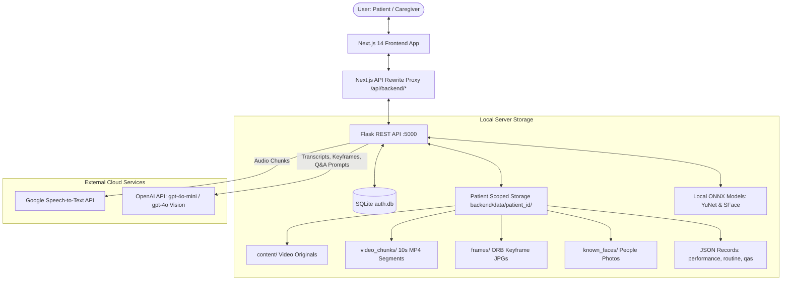

# CogniConnect 🧠

CogniConnect is an AI-assisted memory-support and cognitive practice platform designed for older adults living with mild cognitive impairment, dementia, or Alzheimer’s disease, and for the family caregivers who support them, with an initial regional focus on North East India. Developed for Smart India Hackathon problem **SIH26003 (Ministry of Development of North Eastern Region — MDoNER)**, CogniConnect transforms a person’s own daily video memories, familiar faces, and everyday routines into gentle, pressure-free daily activities and evidence-informed brain exercises.

> [!IMPORTANT]
> **Medical Disclaimer**: CogniConnect is a memory-support, cognitive practice, and daily engagement tool. It is **not a medical device**, does not provide clinical diagnoses, does not deliver medical treatment, and should never replace professional medical evaluation, diagnosis, or care by a qualified healthcare professional.

---

## ✨ Features

### 1. Account Types & Access Modes
CogniConnect provides four distinct, tailored access models to ensure older adults can engage without confusing login interfaces, while caregivers maintain full administrative control:
- **Self-Care Account**: For independent individuals managing their own memory exercises. Includes full personal settings, activity records, self-care video uploads, and the ability to invite trusted family members via time-limited sharing codes (`/pair/invite`).
- **Caregiver Account**: Dedicated portal (`/caregiver`) for family or professional caregivers to manage one or multiple patient profiles, review clinical reports, configure daily routines, pair devices, and customize difficulty.
- **Patient Login Account**: An individual patient account created by a caregiver (`Patients & Devices`) with a dedicated patient email and password. To prevent accidental lockouts, signing out is strictly gated behind the caregiver's 4-digit PIN under *For caregivers*.
- **Paired Patient Device**: A simplified, zero-password mode for dedicated tablets or phones in patient care. Connected via a single-use 8-character pairing code issued by the caregiver (`/pair`). The device session stays active for up to 90 days. Unpairing requires the caregiver's 4-digit PIN. If a caregiver needs to adjust settings on the device, entering the PIN unlocks temporary caregiver mode, which can be closed at any time via **Exit caregiver** without signing out or unpairing.

### 2. My Day & The Daily Plan
- **Automatic Session Builder**: Driven by `build_daily_plan()` in `backend/cognitive_reports.py` and accessed through `GET /daily-plan`.
- **Three-Part Structure**:
  - **Level 1**: Daily Recall ("My Day") bundling video quiz questions, context recall, and face recognition, plus one easy cognitive game.
  - **Levels 2 & 3**: Two targeted cognitive exercises tailored to the patient's current difficulty levels.
- **Streak & Activity Completion**: Daily activity statuses are tracked in local calendar dates (`yyyy-MM-dd`), awarding stars upon completion without high-pressure timers or penalty scoring.

### 3. Cognitive Games Library (19 Registered Games)
CogniConnect features 19 fully implemented, playable games (`comingSoon: false`) defined in `frontend/components/games/registry.ts` and mirrored in `backend/games.json`, categorised into four clinical cognitive domains:

| Cognitive Area | Game Name | Registry ID | Level | Target Cognitive Skill | Description |
|:---|:---|:---|:---:|:---|:---|
| **Memory** | Story Builder | `story-builder` | 1 | Verbal Memory | Read or listen to a short everyday story, then recall missing details. |
| | Relive Memories | `context-recall` | 1 | Personal Memory | Recall details and events of the day’s recorded videos in your own words. |
| | Remember Yesterday | `yesterday-quiz` | 1 | Personal Memory | Recall a journal note, meal, or event recorded from the previous day. |
| | Word Association | `word-association` | 1 | Semantic Memory | Connect related everyday words and cultural concepts (e.g., tea & biscuit). |
| | Matching Pictures | `memory-cards` | 2 | Visual Working Memory | Turn over cards and match familiar paired photographs. |
| | Memory Crossword | `memory-crossword` | 2 | Personal Memory | Complete gentle word puzzles grounded in recent personal memory transcripts. |
| | Mole Path | `mole-path` | 2 | Visual Working Memory | Watch garden circles illuminate and repeat the sequential path. |
| **Attention** | Odd One Out | `odd-one-out` | 1 | Selective Attention | Identify the single item that does not belong in a thematic group. |
| | Listen to the Beats | `sound-tap` | 1 | Auditory Attention | Listen to auditory beats (or count visual pulses) and report the count. |
| | Garden Taps | `whack-a-mole` | 2 | Impulse Inhibition | Tap target garden visitors while leaving resting creatures undisturbed. |
| | Attention Hunt | `attention-hunt` | 3 | Visual Search | Search for specific target symbols amidst distracting visual clutter. |
| **Executive Function** | Plan the Day | `plan-the-day` | 1 | Sequencing | Arrange everyday activities (e.g., wake up, tea, medicine) in logical order. |
| | Sorting Station | `sorting-station` | 2 | Cognitive Flexibility | Sort items according to active rules that dynamically switch mid-round. |
| | Finish the Pattern | `pattern-completion` | 2 | Reasoning | Observe recurring sequences of familiar items and choose the logical next item. |
| | Pill Box Planner | `pill-box-planner` | 2 | Rule Switching | Organize a weekly medication organizer adhering to shifting day/color constraints. |
| **Recognition & Orientation** | Face Recognition | `face-recognition` | 1 | Facial Recognition | Identify familiar family members and friends appearing in the day's memories. |
| | Name Recall | `name-recognition` | 1 | Name-Face Association | Match a familiar loved one's face to their correct name. |
| | Name the Picture | `object-naming` | 1 | Object Naming | Identify common household and cultural objects presented visually. |
| | Map Navigator | `map-navigator` | 3 | Spatial Orientation | Follow directional prompts and navigate landmarks across a local street map. |

*Note*: **Daily Recall** (`daily_recall`, Level 1) serves as an integrated multi-activity bundle incorporating Face Recognition, Context Recall, and Video Questions.

### 4. Adaptive Difficulty Engine
- **Per-Game Knobs (1 to 4)**: Game difficulty automatically adapts between sessions using an Elo-style cognitive rating model (`backend/adaptive.py`).
- **Caregiver Visibility & Overrides**: Caregivers can inspect the adaptive difficulty card in their portal, review score trends, and manually override or lock any game to a specific level (Knob 1 = assisted/simplified, Knob 4 = advanced).

### 5. My Memories (Video Journal & AI Explorer)
- **Chronological Timeline**: Video memories organized by local recording date with thumbnail previews, duration, and processed status indicators.
- **Synchronized Playback**: Continuous playback of 10-second video segments alongside synchronized transcripts and detected faces.
- **Automatic Date Detection**: Uploading a video automatically populates the memory date from the file's `lastModified` timestamp, preserving manual edits.
- **Natural Language Memory Search**: Caregivers and self-care users can query memories in plain English or regional languages (e.g., *"Where did we go last Sunday?"* or *"Who visited for tea?"*), retrieving matching video segments and AI-synthesized contextual answers.
- **Management**: In-app tools to edit memory titles, add journal summaries, or delete videos and associated chunk data.

### 6. My People (Known Faces Directory)
- **Familiar Faces Directory**: Stores photos, full names, relationship labels (e.g., *Daughter*, *Caregiver*, *Neighbor*), and contact phone numbers.
- **Call Shortcut**: Direct telephone dialer link (`tel:`) to easily initiate phone calls with loved ones from tablet view.
- **Face Rescanning**: On-demand background worker that re-encodes known faces and updates historical video tag records when a new person is added.

### 7. Clinical Progress & Doctor's Reports
- **Self-Care View (`/my-progress`)**: Patient-friendly weekly participation breakdown, celebration badges, and star collection counters without clinical jargon.
- **Caregiver Reports Portal (`/progress`, `/report`)**:
  - **Cognitive Radar Chart**: Visual breakdown across Memory, Attention, Executive Function, and Recognition & Orientation.
  - **Longitudinal Trends**: Weekly and monthly score trajectories highlighting stability, improvements, or cognitive decline.
  - **Activity Log**: Detailed chronological log of every game played, level, skill, duration, and percentage score.
  - **Printable Doctor's Summary**: Clean, single-page print stylesheet designed for physical printing or saving as a PDF for clinical consultations.

### 8. Voice Interaction & Accessibility
- **Read-Aloud**: Text-to-speech reading for activity prompts, stories, and memory questions.
- **Spoken Answers**: Patients can speak their answers aloud via microphone; audio is transcribed and evaluated via speech recognition.
- **Accent-Tolerant Voice Matching**: Normalized Levenshtein distance and phonetic matching resolve regional accents, misspellings, and colloquial names (e.g., mapping *"aakaash"* to *"akash"* with high confidence).
- **Interface Ergonomics**: Extra-large touch targets (minimum 56px height on key actions), adjustable text scaling (Large, Larger, Largest), high-contrast light and dark themes, and reduced-motion support.

### 9. Multilingual Support (i18n)
- **Supported Languages**: English (`en`), Hindi (`hi`), and Assamese (`as`).
- **Complete UI Translation**: 464 validated interface phrases translated across games, navigation, dialogue prompts, and caregiver settings.
- *Notice*: Hindi and Assamese strings are machine-translated and currently awaiting native-speaker clinical validation.

### 10. Caregiver Settings & Daily Routine
- **Preference Locks**: Caregivers can selectively lock individual accessibility preferences (e.g., force sound effects on, force animations off, set fixed speech speed) so they cannot be accidentally altered in patient mode.
- **Daily Routine Editor**: Configure 3 to 5 daily activities (e.g., *"Wake up"*, *"Morning walk"*, *"Take blood pressure tablet"*) which dynamically feed the sequencing puzzles in *Plan the Day*.
- **Device Management**: View all paired tablets with last-seen timestamps and unpair devices remotely with a single click.

---

## 🏗️ How It Works & Architecture



### Video Processing Pipeline (`backend/process_video.py`)
When a video is uploaded, it undergoes a fully automated 4-stage pipeline:
1. **Video Chunking**: MoviePy splits the video into sequential 10-second MP4 clips (`chunk_0000_0010.mp4`, etc.) and extracts 16kHz mono PCM WAV audio.
2. **Audio Transcription**: Audio is sent to Google Speech Recognition (`speech_recognition.Recognizer.recognize_google`) to generate timestamped text transcripts saved to `full_transcript.json`.
3. **Keyframe Extraction**: OpenCV processes video frames using **ORB (Oriented FAST and Rotated BRIEF)** keypoint feature descriptors. Only visually distinct frames (descriptor distance delta > 110–200) are saved as JPEG keyframes, filtering out redundant, blurry, or duplicate frames.
4. **Local Face Detection & Recognition**:
   - **Detection**: OpenCV YuNet ONNX model (`face_detection_yunet_2023mar.onnx`) detects faces with confidence threshold $\ge 0.8$.
   - **Feature Recognition**: OpenCV SFace ONNX model (`face_recognition_sface_2021dec.onnx`) extracts 128-dimensional facial embedding vectors.
   - **Matching**: Matches are computed via cosine similarity against reference photos in the patient's `known_faces/` folder. Faces with cosine similarity $\ge 0.363$ are tagged with the person's ID; unmatched faces are marked as Unknown and never stored.
5. **Quiz Generation**: `backend/app.py` passes transcripts, detected people, and caregiver journal notes to OpenAI `gpt-4o-mini` to construct 5 memory quiz questions and concise answers.

### Data Sent to External Services
Only the minimal data required for AI inference leaves the local server:
- **Google Speech Recognition**: Audio WAV chunks (speech audio only, no personal identifiers).
- **OpenAI API**:
  - Memory transcripts, journal notes, and detected person labels for quiz question generation (`gpt-4o-mini`).
  - Extracted keyframe images and search queries for visual memory search (`gpt-4o`).
  - Given answers and expected answers for semantic answer grading (`gpt-4o-mini`).
*No patient account credentials, passwords, session tokens, or raw video streams are ever transmitted to external AI providers.*

---

## 💻 Tech Stack & Versions

### Backend
- **Python**: 3.13+ (tested on Python 3.14 on Windows)
- **Flask**: 3.1.3 (REST API server, application instance named `api`)
- **Flask-CORS**: 6.0.5 (Cross-Origin Resource Sharing handling)
- **OpenCV Python**: 4.10.0.84 (YuNet face detector + SFace face recognizer)
- **MoviePy**: 2.2.1 (Video segmenting and audio stream extraction)
- **SpeechRecognition**: 3.17.0 (Audio processing and Google Speech client)
- **OpenAI Python SDK**: 3.19.2 (GPT-4o Vision and GPT-4o Mini completions)
- **NumPy**: 2.5.3 (Vector distance computations and array math)
- **Pillow**: 11.3.0 (Image parsing and thumbnail processing)
- **python-dotenv**: 1.2.3 (Environment variable management)
- **Werkzeug**: 3.1.8 (Password scrypt hashing and HTTP utilities)
- **Database**: SQLite3 with WAL mode, foreign keys, and busy timeout

### Frontend
- **Framework**: Next.js 14.2.25 (App Router, Server & Client Components)
- **Runtime & UI**: React 18.2.0, React DOM 18.2.0
- **Language**: TypeScript 5.x
- **Styling**: Tailwind CSS 3.3.0, Tailwindcss-Animate 1.0.7
- **UI Primitives**: Radix UI (Dialog, Popover, Select, Separator, Slot, Tabs)
- **Icons**: Lucide React 0.292.0
- **Data Visualization**: Chart.js 4.4.0, React-ChartJS-2 5.2.0
- **Theme**: Next-Themes 0.2.1
- **Date Handling**: Date-Fns 2.30.0, React-Day-Picker 8.9.1
- **Image Optimization**: Sharp 0.33.5

---

## 🚀 Getting Started (Windows PowerShell)

### Prerequisites
- **Python 3.13+**: Ensure `python` is added to your system `PATH`.
- **Node.js 20+**: Ensure `node` and `npm` are installed.
- **Git**: Installed and available in PowerShell.
- **OpenAI API Key**: Required for question generation, visual search, and answer grading.

### 1. Clone the Repository
```powershell
git clone https://github.com/InfiKnight-TGP/Python-EPJ.git
cd Python-EPJ
```

### 2. Backend Setup
```powershell
cd backend

# Create a virtual environment
python -m venv .venv

# Activate the virtual environment
.\.venv\Scripts\Activate.ps1

# Install required Python packages
pip install -r requirements.txt

# Download local YuNet and SFace ONNX face models
python download_models.py

# Create local environment file
Copy-Item .env.example .env
```
Open `backend/.env` in your editor and provide your `OPENAI_API_KEY`:
```env
OPENAI_API_KEY=sk-...your-real-key...
```

### 3. Frontend Setup
```powershell
cd ..\frontend

# Install Node dependencies
npm install

# (Optional) Create local frontend env file
Copy-Item .env.example .env.local
```

### 4. Running the Development Server
From the **root folder** of the repository:
```powershell
cd ..
npm run dev
```
The root `npm run dev` command uses `concurrently` to launch both servers simultaneously:
- **Backend API**: `http://127.0.0.1:5000`
- **Frontend Web App**: `http://localhost:3000`

---

## ⚙️ Modes & Environment Variables

### Variables Reference Table
All variables supported in `backend/.env.example` and `frontend/.env.example`:

| Environment Variable | Source File | Default | Purpose & Description |
|:---|:---|:---:|:---|
| `OPENAI_API_KEY` | `backend/.env` | *empty* | OpenAI API authentication key for question generation, semantic search, and grading. |
| `FLASK_ENV` | `backend/.env` | `development` | Flask runtime environment (`development` or `production`). |
| `COGNI_HOST` | `backend/.env` | `127.0.0.1` | Host address Flask listens on. Safety checks enforce loopback when dev/demo flags are on. |
| `FLASK_DEBUG` | `backend/.env` | `0` | Enables or disables Flask debug reloader. |
| `COGNI_ORIGINS` | `backend/.env` | `http://localhost:3000,http://127.0.0.1:3000` | Comma-separated list of allowed CORS origins for browser API requests. |
| `COGNI_COOKIE_SECURE` | `backend/.env` | `0` | If `1`, session cookies are flagged `Secure` (requires HTTPS). Must be `1` in production. |
| `COGNI_DEV_OTP` | `backend/.env` | *commented* | When enabled, prints OTP verification codes to the backend terminal instead of sending emails. |
| `COGNI_DEV_LOGIN` | `backend/.env` | *commented* | Enables dev account shortcut endpoints (`/auth/dev/patient-device`). Restricted to loopback. |
| `DEV_DEMO_PASSWORD` | `backend/.env` | `demo1234` | Password assigned to seeded development test accounts (`caregiver@demo.local`). |
| `COGNI_DEMO` | `backend/.env` | *commented* | Seeds shared demo accounts/patients and enables fixed OTP/PIN. Restricted to loopback. |
| `DEMO_CAREGIVER_EMAIL` | `backend/.env` | `demo@cogniconnect.com` | Email address for shared demo caregiver account. |
| `DEMO_CAREGIVER_PASSWORD` | `backend/.env` | `Demo@1234` | Password for shared demo caregiver account. |
| `DEMO_PATIENT_EMAIL` | `backend/.env` | `patient@cogniconnect.com` | Email address for shared demo patient login account. |
| `DEMO_PATIENT_PASSWORD` | `backend/.env` | `Patient@1234` | Password for shared demo patient login account. |
| `DEMO_OTP` | `backend/.env` | `123456` | Fixed 6-digit OTP code accepted in demo mode. |
| `DEMO_PAIR_CODE` | `backend/.env` | `DEMA-2345` | Reusable pairing code for demo patient devices. |
| `DEMO_PIN` | `backend/.env` | `1234` | Fixed 4-digit caregiver PIN for the demo patient. |
| `COGNI_DEMO_PUBLIC` | `backend/.env` | `0` | If `1`, allows demo mode requests from non-loopback IPs (caution: demo only). |
| `SMTP_USER` | `backend/.env` | *empty* | SMTP email username for delivering authentication OTP codes. |
| `SMTP_PASS` | `backend/.env` | *empty* | SMTP email password or application password. |
| `NEXT_PUBLIC_DEV_LOGIN` | `frontend/.env` | *commented* | Displays development shortcut login buttons on the web login screen. |
| `NEXT_PUBLIC_DEMO` | `frontend/.env` | *commented* | Displays pre-filled demo credential cards on the login and device pairing screens. |

> [!WARNING]
> **Production Security Rules**: Never enable `COGNI_DEV_LOGIN`, `COGNI_DEMO`, or `NEXT_PUBLIC_*` development flags on any publicly accessible server. Never host demo mode alongside real patient data. Public deployments must enforce HTTPS and set `COGNI_COOKIE_SECURE=1`.

---

## 🔒 Security & Privacy

CogniConnect adheres to privacy-by-design principles tailored for sensitive memory care data:

- **What Is Stored Locally**:
  - `backend/auth.db`: SQLite database storing user names, email addresses, cryptographically salted and hashed passwords (`scrypt`), session tokens, single-use pairing codes, and hashed OTPs.
  - `backend/data/<patient_id>/`: Fully isolated directory structure per patient containing uploaded videos (`content/`), 10-second segments (`video_chunks/`), keyframe images (`frames/`), face photos (`known_faces/`), and JSON performance logs.
- **Per-Patient Scoping**: Access control decorators (`@login_required`, `@caregiver_required`) verify patient membership on every request. Caregivers can only read or modify patients explicitly linked to their account.
- **No Third-Party Tracking**: CogniConnect contains **zero advertisements**, no third-party marketing trackers, and no global public leaderboards.
- **Tests Isolation Invariant**: All automated unit tests in `backend/tests/` use fixture mocks for AI and speech services. **Automated test runs never invoke external OpenAI or Google APIs**.
- **Data Deletion**: Caregivers and self-care users can delete individual memories, contact people, or request total patient data purging through the API at any time.

---

## 📊 System Evaluation Metrics

The following metrics are copied directly from the empirical benchmark report in [`docs/EVALUATION.md`](file:///e:/Cogni-Connect/docs/EVALUATION.md).

> [!NOTE]
> *Evaluation Setup*: Tested on Windows 11 (AMD64), Python 3.14, using `content/Me_at_the_zoo.mp4`, 240p video chunks, and 4 known face references (Akash, Dinesh, Nikhil, Jawed Karim). **These metrics reflect a small, controlled test set and are indicative of pipeline performance rather than clinical validation.**

### 1. Face Recognition Benchmarks (OpenCV YuNet + SFace)
- **Detector**: OpenCV YuNet (`face_detection_yunet_2023mar.onnx`, confidence score threshold: `0.8`)
- **Recognizer**: OpenCV SFace (`face_recognition_sface_2021dec.onnx`, cosine threshold: `0.363`)
- **Precision (Known People)**: `100.0%`
- **Recall (Known People)**: `100.0%`
- **Unknown Faces Ratio**: `5.9%` (3 of 51 detections classified as Unknown due to extreme angle or blur)
- **True Match Cosine Similarity**: Mean `0.7515`, Median `0.8014` (range: `0.0938` to `0.8457`)
- **Other Faces Cosine Similarity**: Mean `0.0481`, Median `0.0307` (cleanly below `0.363` threshold)

### 2. Audio Transcription Accuracy (Word Error Rate - WER)
- **Google Speech Recognition**: **`0.00%` WER** (matched word-for-word on reference audio)
- **Whisper (`whisper-1`)**: **`2.63%` WER** (1 substitution: *"in front of the elephants. The cool"* vs reference *"in front of the elephants, and the cool"*)

### 3. Pipeline Latency Benchmarks (Median / P90 over 5 runs)
- **Video Processing Per Minute Video**: `30.34s` median / `32.33s` P90
- **Transcribe 5s Clip**: `2.12s` median / `3.50s` P90
- **Answer Accuracy Scoring**: `0.79s` median / `0.95s` P90
- **Question Generation (`gpt-4o-mini`)**: `3.66s` median / `4.16s` P90
- **Semantic Memory Search**: `2.06s` median / `2.90s` P90
- **Daily Plan Generation**: `0.003s` (3.1ms) median / `0.004s` P90
- **Memory Crossword Generation**: `0.002s` (2.1ms) median / `0.008s` P90
- **Daily Reports Computation**: `0.003s` (3.2ms) median / `0.004s` P90

### 4. Answer Grading Agreement
- **Bucket Agreement (10 hand-written pairs)**: `90.0%` (9/10 bucket agreement between AI grading and human clinical reviewer).
- **Spearman Rank Correlation**: `0.964`

### 5. Accent-Tolerant Voice Matching
- Tested against 20 spelling and accent variants (e.g., *"denish"*, *"nikil"*, *"aakaash"*):
  - Direct Accept: `30.0%` (6/20)
  - Confirmation Prompt: `50.0%` (10/20)
  - Rejection / Retry: `20.0%` (4/20)
  - **Routing Accuracy**: `100.0%` (0 misdirected names)

### 6. Adaptive Difficulty Simulation (30 Sequential Questions)
- **Struggling Player** (20% accuracy, 5000ms latency): Initial Knob 2 $\rightarrow$ Final **Knob 1** (Rating 772).
- **Average Player** (60% accuracy, 2500ms latency): Initial Knob 2 $\rightarrow$ Final **Knob 4** (Rating 1068).
- **Strong Player** (95% accuracy, 1200ms latency): Initial Knob 2 $\rightarrow$ Final **Knob 4** (Rating 1298).

---

## 📁 Project Structure

```
Cogni-Connect/
├── backend/                             # Python Flask API and processing pipeline
│   ├── app.py                           # Flask REST API server (api object, 46 endpoints)
│   ├── auth.py                          # Auth blueprint (bp object, session & pairing logic)
│   ├── process_video.py                 # 4-stage video chunking, transcription & face detection
│   ├── cognitive_reports.py             # Daily plan builder, clinical report calculations
│   ├── adaptive.py                      # Elo-based difficulty rating and knob adjustments
│   ├── db.py                            # SQLite database wrapper with WAL and transaction helper
│   ├── patient_storage.py               # Patient-scoped path resolution & data isolation
│   ├── mailer.py                        # SMTP email and OTP verification dispatcher
│   ├── games.json                       # Authoritative cognitive games registry specification
│   ├── download_models.py               # Script to fetch YuNet and SFace ONNX models
│   ├── requirements.txt                 # Backend Python package requirements
│   ├── .env.example                     # Environment template for backend variables
│   ├── models/                          # Local ONNX neural network weights for face tasks
│   │   ├── face_detection_yunet_2023mar.onnx
│   │   └── face_recognition_sface_2021dec.onnx
│   ├── data/                            # Per-patient scoped storage (backend/data/<patient_id>/)
│   │   └── <patient_id>/                # Individual isolated patient directory
│   │       ├── content/                 # Original video journal files
│   │       ├── video_chunks/            # 10s MP4 segments and transcript JSONs
│   │       ├── frames/                  # Extracted unique keyframe JPEGs
│   │       ├── known_faces/             # Cropped photos of loved ones
│   │       └── *.json                   # Patient records (performance, routine, preferences)
│   └── tests/                           # Complete automated backend unit test suite (161 tests)
│
├── frontend/                            # Next.js 14 Web Application
│   ├── app/                             # App Router pages and route handlers
│   │   ├── layout.tsx                   # Root HTML layout with providers and theme wrappers
│   │   ├── page.tsx                     # Main Home dashboard (patient & self-care)
│   │   ├── welcome/page.tsx             # Public landing screen with account selection
│   │   ├── login/page.tsx               # Email/password authentication screen
│   │   ├── signup/page.tsx              # Account creation screen (caregiver or self-care)
│   │   ├── verify/page.tsx              # 6-digit email OTP verification screen
│   │   ├── pair/page.tsx                # Patient device pairing screen
│   │   ├── today/page.tsx               # Patient "My Day" 3-step daily activity flow
│   │   ├── explore/page.tsx             # Memory explorer video player with AI search
│   │   ├── games/page.tsx               # All games library view
│   │   ├── people/page.tsx              # "My People" familiar faces directory and dialer
│   │   ├── routine/page.tsx             # Daily Routine sequence manager
│   │   ├── settings/page.tsx            # Patient & self-care settings (includes Account)
│   │   ├── caregiver/                   # Caregiver portal views
│   │   │   ├── page.tsx                 # Caregiver patient overview dashboard
│   │   │   └── settings/page.tsx        # Caregiver settings (Patients & Devices, Account)
│   │   ├── progress/page.tsx            # Clinical progress analytics and radar charts
│   │   ├── report/page.tsx              # Printable clinical doctor's report
│   │   ├── privacy/page.tsx             # Privacy policy and data storage explanation
│   │   ├── terms/page.tsx               # Terms of use and non-medical disclaimer
│   │   └── about/page.tsx               # About CogniConnect (SIH26003 MDoNER background)
│   ├── components/                      # Reusable React components
│   │   ├── nav.tsx                      # App shell: desktop sidebar and mobile bottom tab bar
│   │   ├── dashboardCard.tsx            # Standardized Duolingo-style action cards
│   │   ├── auth/                        # Account forms, SignOutButton, and pairing panels
│   │   ├── caregiver/                   # PIN dialogs, difficulty knobs, and caregiver guards
│   │   ├── games/                       # 19 cognitive game modules and shared shells
│   │   ├── memories/                    # UploadMemoryDialog, video player, and memory modals
│   │   └── interaction/                 # Speech input, audio read-aloud, and i18n providers
│   ├── lib/                             # Client helpers, state contexts, and test scripts
│   │   ├── auth-context.tsx             # AuthProvider context managing active user and patient
│   │   ├── progress.ts                  # Local calendar date normalisation and score utilities
│   │   ├── stats.ts                     # Patient streak, star calculation, and badge metrics
│   │   ├── interaction/locales/         # i18n translation dictionaries (en, hi, as)
│   │   └── *.check.mjs                  # 13 automated frontend test and verification suites
│   ├── package.json                     # Frontend package manifest and dependencies
│   └── .env.example                     # Environment template for frontend variables
│
├── docs/                                # Technical documentation and benchmark reports
│   ├── AUTH_FLOWS.md                    # Authentication lifecycle, session guards, and routing
│   └── EVALUATION.md                    # Empirical accuracy, latency, and algorithmic evaluation results
│
├── package.json                         # Root project manifest with concurrent run scripts
├── AGENTS.md                            # Core project facts, rules, and verification checklist
└── README.md                            # Comprehensive project overview (this file)
```

---

## 🧪 Testing & Verification Checks

CogniConnect enforces rigorous quality checks across both the frontend and backend. Automated verification can be executed at any time using the exact commands specified in [`AGENTS.md`](file:///e:/Cogni-Connect/AGENTS.md):

### 1. Frontend Verification Checks
Run from the `frontend/` directory:
```powershell
cd frontend

# TypeScript strict type checking (0 errors required)
npx tsc --noEmit

# Core logic and safety invariant checks
node lib/progress.check.mjs
node lib/self-progress.check.mjs
node lib/word-association.check.mjs
node lib/whack-a-mole.check.mjs
node lib/pill-box-planner.check.mjs
node lib/nav.check.mjs
node lib/interaction/locales.check.mjs
node lib/auth.check.mjs
node lib/explore.check.mjs
node lib/games-self.check.mjs
node lib/routine-self.check.mjs
node lib/people-self.check.mjs
node lib/video-upload.check.mjs
```

### 2. Backend Test Suite
Run from the `backend/` directory using the dedicated virtual environment:
```powershell
cd backend

# Verify import integrity
.\.venv\Scripts\python.exe -c "import app"

# Run cognitive reports and daily plan tests
.\.venv\Scripts\python.exe -m unittest tests/test_cognitive_reports.py

# Run device unpairing and PIN protection tests
.\.venv\Scripts\python.exe -m unittest tests/test_device_unpair.py

# Run the complete automated test suite (161 tests)
.\.venv\Scripts\python.exe -m unittest discover tests
```
*Current test status*: **161 backend tests passing (100% OK)**, **13 frontend checks passing**, and **0 TypeScript diagnostics**.

---

## 📡 API Overview

All backend endpoints defined across `backend/app.py` and `backend/auth.py`, organized by functional area:

### 1. Authentication & Pairing (`backend/auth.py`)
- `POST /auth/signup` — Public: Register caregiver or self-care account; issues 6-digit email OTP.
- `POST /auth/login` — Public: Email and password authentication; issues OTP or verifies trusted session.
- `POST /auth/otp/verify` — Public: Verifies 6-digit challenge code; issues session cookie.
- `POST /auth/otp/resend` — Public: Re-issues a fresh 6-digit OTP code.
- `POST /auth/forgot` — Public: Initiates password reset challenge.
- `POST /auth/reset` — Public: Completes password reset and revokes prior sessions.
- `POST /auth/password` — *Caregiver / Self*: Updates password for current account.
- `POST /auth/logout` — *Authenticated*: Terminates active session and clears cookies.
- `GET /auth/me` — *Authenticated*: Returns active user role, linked patients, and active patient context.
- `POST /pair/create` — *Caregiver / Self Owner*: Creates an 8-character single-use pairing code for a patient device.
- `POST /pair/invite` — *Caregiver / Self Owner*: Creates a 48-hour invite code to share patient access with another caregiver.
- `POST /pair/redeem` — Public: Redeems a pairing code to establish a `patient_device` session.
- `POST /pair/join` — *Caregiver / Self*: Redeems a caregiver invite code to gain access to a patient.
- `GET /pair/devices` — *Caregiver*: Lists all devices paired with the active patient.
- `DELETE /pair/devices/<id>` — *Caregiver*: Remotely revokes a paired device.
- `POST /caregiver/unlock` — *Patient Device*: Elevates session using the patient's 4-digit PIN.
- `POST /caregiver/lock` — *Authenticated*: Relocks an elevated session back to patient mode.
- `POST /device/unpair` — *Patient Device*: Unlinks the device from the patient profile (requires 4-digit PIN).
- `POST /auth/dev/patient-device` — Loopback Only: Development shortcut to establish a paired device session.
- `POST /demo/reset` — *Caregiver / Demo Only*: Restores demo patient data and fixtures.

### 2. Patients & Membership (`backend/auth.py`)
- `GET /patients` — *Caregiver / Self*: Lists all patient profiles accessible to the user.
- `POST /patients` — *Caregiver*: Creates a new patient profile.
- `GET /patients/<id>/members` — *Patient Member*: Lists all caregivers with access to this patient.
- `DELETE /patients/<id>/members/<user>` — *Patient Owner*: Revokes another caregiver's access.
- `POST /patients/<id>/pin` — *Caregiver / Owner*: Sets or changes the patient's 4-digit caregiver PIN.
- `GET /patients/<id>/login` — *Caregiver*: Checks if a patient-login email is configured.
- `POST /patients/<id>/login` — *Caregiver*: Creates or updates dedicated patient login credentials.
- `DELETE /patients/<id>/login` — *Caregiver*: Removes dedicated patient login credentials.

### 3. Memories & Video Processing (`backend/app.py`)
- `GET /memories` — *Authenticated*: Lists chronological video memories with metadata and processing status.
- `POST /memories` — *Caregiver / Self*: Uploads a video memory with title, date, and journal notes.
- `GET /memories/<id>` — *Authenticated*: Retrieves detailed memory metadata.
- `PATCH /memories/<id>` — *Caregiver / Self*: Updates memory title, date, or journal summary.
- `DELETE /memories/<id>` — *Caregiver / Self*: Deletes video file, segments, frames, and associated records.
- `POST /memories/<id>/retry` — *Caregiver / Self*: Retries processing for a failed video.
- `GET /memories/<id>/video` — *Authenticated*: Streams the memory video file.
- `GET /memories/<id>/thumbnail` — *Authenticated*: Serves thumbnail image.
- `GET /memories/limits` — *Authenticated*: Returns patient storage usage against the 2 GB quota.
- `POST /memories/ask` — *Authenticated*: Natural-language visual Q&A search over memories.
- `GET /video_chunks` — *Authenticated*: Lists all processed 10-second MP4 video segments.
- `GET /video_chunks/<path>` — *Authenticated*: Streams a specific 10-second segment.
- `GET /frames/<path>` — *Authenticated*: Serves an extracted keyframe JPEG.

### 4. Known People & Face Recognition (`backend/app.py`)
- `GET /people` — *Authenticated*: Lists known loved ones, relationships, and phone numbers.
- `POST /people` — *Caregiver*: Adds a new person with name, relationship, phone, and portrait photo.
- `PUT /people/<id>` — *Caregiver*: Updates person details or replaces photo.
- `DELETE /people/<id>` — *Caregiver*: Removes person and deletes portrait photo.
- `GET /known-faces/<filename>` — *Authenticated*: Serves cropped face reference photo.
- `POST /people/rescan` — *Caregiver*: Initiates background re-scan of video segments for newly added people.
- `GET /people/rescan/status` — *Caregiver*: Returns active re-scanning status.

### 5. Games, Performance & Daily Plan (`backend/app.py`)
- `GET /daily-plan` — *Authenticated*: Generates the 3-activity daily session based on user difficulty.
- `GET /performance` — *Authenticated*: Returns historical activity scores and timestamps.
- `POST /performance` — *Patient Device / Self*: Records activity completion score (`0–100`).
- `DELETE /performance/<id>` — *Caregiver*: Removes an errant performance record.
- `GET /crossword` — *Authenticated*: Generates a memory crossword from recent transcripts.
- `GET /faces-for-date` — *Authenticated*: Returns people recognized in videos recorded on a specific date.

### 6. Adaptive Difficulty & Preferences (`backend/auth.py` & `backend/app.py`)
- `GET /adaptive` — *Authenticated*: Returns current adaptive ratings and difficulty knobs (1–4) per game.
- `PUT /adaptive/state` — *Patient Device / Self*: Updates player rating following a game.
- `POST /adaptive/override` — *Caregiver*: Manually overrides and locks difficulty for a game.
- `POST /adaptive/reset` — *Caregiver*: Resets difficulty ratings back to baseline (Knob 2 / rating 1000).
- `GET /preferences` — *Authenticated*: Retrieves patient accessibility preferences and locks.
- `PUT /preferences` — *Authenticated*: Saves updated accessibility toggles.
- `POST /preferences/reset` — *Caregiver*: Resets accessibility preferences to defaults.

### 7. Reports, Routine & Settings (`backend/app.py`)
- `GET /reports/days` — *Authenticated*: Returns daily score summary list for calendar heatmap.
- `GET /reports/day` — *Caregiver*: Returns detailed day breakdown and clinical area averages.
- `GET /routine` — *Authenticated*: Retrieves the 3 to 5 daily routine sequence steps.
- `POST /routine` — *Caregiver / Self*: Updates the daily routine sequence steps.
- `GET /settings` — *Authenticated*: Returns patient display name and preferred language code.
- `POST /settings` — *Caregiver / Self*: Updates patient display name and interface language.
- `GET /health` — Public: Health check returning server uptime and status.

---

## 🗺️ Roadmap

### Built in Current Release
- Four distinct access models: Self-care, Caregiver, Patient Login, and PIN-paired Patient Device.
- 19 fully registered cognitive games spanning 4 clinical areas.
- Automated 4-stage video processing pipeline (10s chunking, Google Speech transcription, ORB keyframes, OpenCV YuNet/SFace recognition).
- Three-part Daily Plan generator and longitudinal cognitive report tracking with printable doctor summaries.
- Elo-based adaptive difficulty engine with caregiver manual override knobs.
- Trilingual interface support (English, Hindi, Assamese) with 464 translated phrases.
- Voice-first interactions: Text-to-speech read aloud and accent-tolerant fuzzy voice answer matching.

### Planned Enhancements
- **My Places**: Interactive familiar places directory populated with Google Maps links and visual landmark anchors.
- **Device-to-Caregiver SOS**: Direct one-tap emergency call and alert button on paired patient devices notifying linked caregivers.
- **Personalized Puzzles**: Dynamic generation of *Plan the Day* and *Story Builder* scenarios synthesized directly from the patient’s own Daily Routine and video transcripts.
- **Enhanced Map Scenarios**: Expanded landmark and routing scenarios in *Map Navigator* modeled after real local neighbourhoods.

### Long-Term Considerations
- **Places Autocomplete**: Integration of Google Places API for seamless location selection.
- **Emergency Dialing**: 112 emergency service quick-dialer and SMS notification dispatch.
- **Cloud Hosting Architecture**: Production migration to HTTPS, managed PostgreSQL (Supabase), and S3-compatible cloud object storage.
- **Clinical Language Validation**: Comprehensive review and refinement of Hindi, Assamese, and additional regional language translations by native-speaker healthcare professionals.
- **Caregiver Field Pilot**: Formal user experience evaluation with dementia care organizations and elderly care centers in North East India.

---

## ⚠️ Known Limitations

1. **Machine-Translated Regional Locales**: Hindi and Assamese strings are currently machine-translated and require formal clinical and linguistic review by native speakers before clinical deployment.
2. **In-Memory Rate Limiting**: Security rate limits (e.g., login attempts, PIN verification counters) are stored in server memory and reset when the Flask process restarts.
3. **Processing Latency**: High-definition video processing requires approximately 30 seconds per minute of video; users must await background completion before new memory quizzes become available.
4. **Internet Dependency for AI Services**: While face recognition and game logic run entirely offline, audio transcription (Google Speech) and quiz generation (OpenAI) require an active internet connection.
5. **Small Benchmark Evaluation Set**: Empirical benchmarks were measured on a single representative dataset (`Me_at_the_zoo.mp4` fixture) and serve as performance indicators rather than broad population studies.
6. **Not Clinically Validated**: CogniConnect has not undergone formal clinical trials or FDA/CDSCO medical device certification.

---

## 👥 Team

<!-- GitHub removes style attributes on avatars, so images may render square in markdown view -->
<p>
  <a href="https://github.com/InfiKnight-TGP">
    
  </a>
  &nbsp;&nbsp;
  <a href="https://github.com/robotaves-max">
    
  </a>
  &nbsp;&nbsp;
</p>

*Verified repository contributors (from GitHub API & commit history)*:
- **InfiKnight-TGP** (Repository Owner)
- **robotaves-max** (Collaborator)

---

## 🤝 Contributing & License

### Contributing Guidelines
1. Create a dedicated feature branch for each change (`git checkout -b feature/your-feature-name`).
2. Run all frontend and backend verification checks listed in [`AGENTS.md`](file:///e:/Cogni-Connect/AGENTS.md) before submitting code.
3. Keep commits atomic, well-documented, and never push directly to `main`.
4. Ensure no secrets, API keys, or raw personal data are committed.

### License
There is currently no formal open-source `LICENSE` file present in this repository. All rights are reserved by the repository maintainers unless explicitly stated otherwise. Do not assume MIT or other permissive licensing terms until an official license file is added.

### Acknowledgments
- **OpenCV Team**: YuNet face detector and SFace face recognition ONNX models.
- **MoviePy & SpeechRecognition**: Robust media manipulation and audio transcription pipelines.
- **OpenAI**: Language and vision models supporting memory question generation.
- **Next.js & Vercel**: App Router and server rendering capabilities.
- **Radix UI & Tailwind CSS**: Accessible component primitives and ergonomic styling.
- **Smart India Hackathon (SIH 2024 / MDoNER)**: Problem statement SIH26003 inspiring technology-assisted memory care for North East India.

### Documentation References
- [`AGENTS.md`](file:///e:/Cogni-Connect/AGENTS.md) — Core architecture facts, strict development rules, and verification suite commands.
- [`docs/AUTH_FLOWS.md`](file:///e:/Cogni-Connect/docs/AUTH_FLOWS.md) — Exhaustive authentication flows, role guards, and session state diagrams.
- [`docs/EVALUATION.md`](file:///e:/Cogni-Connect/docs/EVALUATION.md) — Empirical accuracy, latency, and algorithmic evaluation results.
