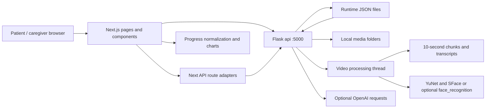

# CogniConnect architecture

## Baseline and scope

The baseline sections describe the application inspected on 13 October 2026.
The feature-branch extension below describes the current additions and boundaries.
It is a Next.js 14 App Router / React 18 / TypeScript frontend with a Flask
backend whose application object is `api`. Tailwind, Radix primitives and
Chart.js provide the interface. There is no database server: the baseline
stores runtime data in JSON and media in local folders. The platform supports
engagement and caregiver observation; it does not diagnose or treat dementia.

## Folder map

| Path | Responsibility |
| --- | --- |
| `package.json` | Windows setup and concurrent frontend/backend development commands |
| `backend/app.py` | HTTP endpoints, uploads, people, routines, settings, scores, reports and AI requests |
| `backend/cognitive_reports.py` | Four-domain aggregation and stable daily plans |
| `backend/games.json` | Backend game metadata and ready/coming-soon status |
| `backend/process_video.py` | Video chunking, transcription, frame selection and face recognition |
| `backend/download_models.py` | Download optional OpenCV face models |
| `backend/sample_data/` | Example JSON, not automatically loaded into runtime stores |
| `backend/tests/` | unittest coverage for reports, settings and performance |
| `frontend/app/` | Patient, caregiver, games, quiz, upload, people and report routes |
| `frontend/app/api/` | Server route adapters for questions, accuracy, search and videos |
| `frontend/components/nav.tsx` | Sidebar and mobile navigation |
| `frontend/components/caregiver/` | Settings, logs, day snapshots and progress summaries |
| `frontend/components/quiz/` | Face selection, personal context recall and My Day orchestration |
| `frontend/components/games/registry.ts` | Frontend game catalog and component mapping |
| `frontend/components/games/_shared/` | GameShell lifecycle, large tiles and score saving |
| `frontend/lib/progress.ts` | Local day normalization, score/domain mapping, trends and patient statistics |
| `frontend/lib/mode.ts` | Session-local caregiver UI state and PIN unlock request |

## Data flow

`NEXT_PUBLIC_API_URL` defaults to `http://localhost:5000`. Next rewrites media
URLs for video chunks and known faces to Flask. Uploads persist metadata in
`video_journals.json`; background processing uses MoviePy, SpeechRecognition's
Google recognizer, OpenCV ORB frame selection, and either optional dlib-based
face_recognition or OpenCV YuNet/SFace models. It writes chunks, transcripts and
recognized person IDs. Existing AI search, answer scoring and question generation
call OpenAI and require a configured key; they are not offline features.

People have stable IDs, names, relationships and photo filenames. Runtime
`people.json` can initially import known face files. `routines.json` holds 3–5
ordered steps. `settings.json` stores a hashed caregiver PIN, patient name,
language and game pins. The legacy default PIN is 1234. The baseline PIN is a
UI soft lock, not server-side authorization: do not expose that API publicly.

`POST /performance` writes scores to `performance_data.json`. Legacy bundled
Daily Recall entries have activity breakdowns; newer standalone games use
`game_scores`. `GameShell` handles start, finish, restart and score clamping,
and avoids saving caregiver previews. `saveScore` sends the score to Flask.
Reports and frontend progress normalizers handle both record forms. Dates are
local calendar `yyyy-MM-dd`, using `dayKey` or shared date helpers.

`build_daily_plan()` is shared by `/daily-plan` and daily reports. Level 1 has
My Day plus one easy game, and levels 2 and 3 have two games each. Plans are
seeded by the day and persisted for past/current days; recorded days remain
stable. Caregiver pins override eligible unplayed future selections. Each game
has exactly one catalog level and one primary domain. Changing in-game knobs
must not change this catalog contract.

## Existing games

| ID | Catalog level / domain | Actual implementation |
| --- | --- | --- |
| `story-builder` | 1 / Memory | Two four-sentence stories, three missing-word choices per story; score correct / 6; optional English TTS |
| `context-recall` | 1 / Memory | Wraps personal context questions from day-specific video memories; existing AI answer scoring |
| `plan-the-day` | 1 / Executive Function | Five ordering rounds: two tasks, two errand constraints, then day photos or caregiver routine; 20 points per round |
| `mole-path` | 2 / Memory | Repeat flashing positions on a 3x3 grid; five rounds, length grows on success, one replay; longest correct path / 7 |
| `sorting-station` | 2 / Executive Function | Two rounds of 12 items, two rules per round; correct / 24; rule-switch errors currently console-only |
| `attention-hunt` | 3 / Attention | Find copies of a target among distractors; session generation and scoring in `logic.ts` |
| `map-navigator` | 3 / Recognition & Orientation | Four rounds on a connected 4x4 town graph; remember destinations then navigate; BFS route efficiency minus hint penalties |
| `face-recognition` | 1 / Recognition & Orientation | Reuses quiz PersonSelect against recognized people from a selected day's videos |
| `name-recognition` | 1 / Recognition & Orientation | Three familiar-person rounds; first-correct gives 1, correction gives 0.5, revealed gives 0; requires three photo profiles |
| `word-association` | 1 / Memory | Coming-soon component, not a playable game |
| `odd-one-out` | 1 / Attention | Coming-soon component at baseline |
| `whack-a-mole` | 2 / Attention | Coming-soon component, not a playable game |
| `pill-box-planner` | 2 / Executive Function | Catalog placeholder without a component |

My Day orchestrates existing personal-memory activities. Patient screens omit
catalog level/domain terminology. The map currently includes a memorization
countdown and name recall advances after feedback; these are existing behaviors,
not evidence of a patient-baseline adaptive system.

## Running and checking the baseline

Use Node 24 (the standalone checks import TypeScript directly) and Python in
`backend/.venv`. Run `npm ci` at root and frontend, create the venv and install
`backend/requirements.txt`, then `npm run dev` at root. Optional face processing
also needs `backend/download_models.py` and its model downloads. The UI is on
3000 and Flask on 5000. Stop development servers before a production build.

Checks: frontend `npx tsc --noEmit`, `node lib/progress.check.mjs`, and
`node components/games/plan-the-day/rules.check.mjs`; backend
`.venv\Scripts\python.exe -m unittest discover -s tests` and
`.venv\Scripts\python.exe -c "import app"`.

## Baseline limitations

The existing app has no patient-account isolation, durable offline queue,
service worker, server-enforced caregiver role, location consent workflow or
cross-game speech-answer interface. JSON writes are not a transactional
multi-user database. Public media copies are unsuitable for sensitive production
uploads. README claims about security or offline operation must be assessed
against these actual code paths.

## Current feature-branch extension

The original Flask/Next stack and legacy routes are retained. The new support
workspace uses a separate SQLite store; it does not turn the legacy JSON API
into a multi-tenant service. `/play` lists playable registry entries without
caregiver level/domain labels. `/support` has explicit patient/caregiver accounts.

| Path | Responsibility |
| --- | --- |
| `backend/platform_api.py` | Scoped accounts, hashed passwords, session cookies, LWW records, private recordings |
| `backend/seed_platform.py` | SIMULATED declining history through the actual auth/record API |
| `frontend/components/interaction/` | Mode selector, speech question controls, event logging hook, offline preparation |
| `frontend/lib/interaction/` | Speech interface, matching, preferences, adaptive engine, trends, content, queue and storage |
| `frontend/lib/interaction/locales/` | Discovered en/hi/as interaction strings and answer variants; not complete game translations |
| `frontend/components/support/` | Journal, reminders, messages, places, caregiver overview, crossword and persistent SOS |
| `frontend/public/sw.js` | Patient shell/static-asset offline responses; never caches API or authentication responses |
| `frontend/scripts/offline-assets.mjs` | Post-build static asset manifest |
| `frontend/tests/e2e/` | Mocked-speech browser tests and isolated real-Flask support integration |

```mermaid
flowchart LR
  UI[Patient games and support workspace] --> Speech[SpeechProvider and answer matcher]
  Speech --> Answer[Existing game answer handler]
  Answer --> Events[Per-profile events and adaptive state]
  UI --> Local[LocalStorage records and pending queue]
  Events --> Local
  UI --> IDB[IndexedDB recordings]
  Local --> Sync[Authenticated sync]
  IDB --> Sync
  Sync --> Proxy[Next platform-api rewrite]
  Proxy --> Auth[Flask session and role checks]
  Auth --> DB[Patient-scoped SQLite records]
  Auth --> Media[Private hashed media paths]
  DB --> Dashboard[Caregiver session trends and alerts]
  Cache[Service worker patient cache] --> UI
```

`SpeechProvider` defaults to Web Speech. Questions read aloud before listening;
unknown/fuzzy recognition asks for confirmation. Voice timing ends at speech
start, not transcript delivery. Only the active provider owns cancellation;
late callbacks are detached. No key is needed, but STT may require connectivity
and a browser-provided language service. Read mode never automatically listens.

Support records are keyed by patient and ID, with client millisecond timestamps.
Sync pulls remote records, sends at most 100 eligible pending records, and merges
last-write-wins responses without acknowledging edits made during upload. SOS
records are prioritized. `X-Cogni-Patient` binds each sync read/write and media
upload to its initiating profile; a changed session returns 409. Media blobs
upload before their journal record. Consent checks gate location sync; old
records retained locally after revocation are not deletion requests.

Authenticated GameShell scores use scoped support records. Guest scores retain
the legacy performance route and also have a local record. Legacy reports still
read their original JSON data; the support dashboard reads scoped answer events.
There is no automatic migration or combined multi-patient legacy dashboard.

New or completed games retain one catalog level and one of the four domains:

| ID | Domain; all catalog level 1 | Mechanics |
| --- | --- | --- |
| `odd-one-out` | Attention | Eight familiar-picture rounds; adaptive choice count; correct / 8 |
| `memory-cards` | Memory | Two to five pairs selected at session start; explicit next-pair action; pairs / attempts |
| `sound-tap` | Attention | Six beat-count rounds; optional visual dots; adaptive beat range; correct / 6 |
| `pattern-completion` | Recognition & Orientation | Six repeating-picture rounds; two- or three-item patterns |
| `object-naming` | Recognition & Orientation | Six object rounds; voice or choice tiles; adaptive choice count |
| `yesterday-quiz` | Memory | Up to five actual yesterday journal summaries; only distinct older summaries can be distractors |

Attention Hunt and Map Navigator no longer impose their old countdowns. Existing
games reuse GameShell and their original routes/data. Personal crossword is a
support activity: a 15x15 legal-intersection grid from entered personal words and
saved place names, persisted solved words, typed/confirmed voice input, template
clues and difficulty-dependent word length/given letters. Not every legacy game
applies an adaptive knob yet; see `ADAPTIVE_ENGINE.md`.

The caregiver view aggregates answer events into session percentages before
fitting decline slopes. Its experimental index combines available accuracy,
adherence, journal activity and personal voice timing evidence. Missing signals
are omitted, not invented. SOS is a server inbox record, not an external emergency
dispatch. Media/location hardware and native-language speech still need manual
acceptance. See `WORK_PROGRESS.md` for executed tests and unresolved requirements.
