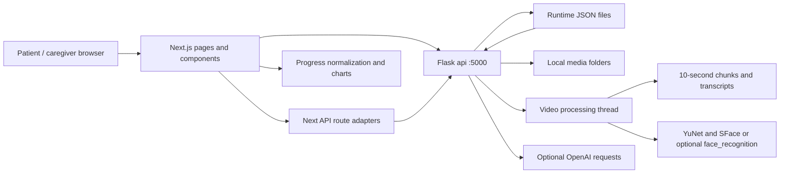

# CogniConnect architecture

## Baseline and scope

This document describes the existing application inspected on 13 October 2026.
It is a Next.js 14 App Router / React 18 / TypeScript frontend with a Flask
backend whose application object is `api`. Tailwind, Radix primitives and
Chart.js provide the interface. There is no database server: the baseline
stores runtime data in JSON and media in local folders. The platform supports
engagement and caregiver observation; it does not diagnose or treat dementia.

## Folder map

| Path | Responsibility |
| --- | --- |
| `package.json` | Windows setup and concurrent frontend/backend development commands |
| `backend/app.py` | HTTP endpoints, uploads, people, routines, settings, scores, reports and AI requests |
| `backend/cognitive_reports.py` | Four-domain aggregation and stable daily plans |
| `backend/games.json` | Backend game metadata and ready/coming-soon status |
| `backend/process_video.py` | Video chunking, transcription, frame selection and face recognition |
| `backend/download_models.py` | Download optional OpenCV face models |
| `backend/sample_data/` | Example JSON, not automatically loaded into runtime stores |
| `backend/tests/` | unittest coverage for reports, settings and performance |
| `frontend/app/` | Patient, caregiver, games, quiz, upload, people and report routes |
| `frontend/app/api/` | Server route adapters for questions, accuracy, search and videos |
| `frontend/components/nav.tsx` | Sidebar and mobile navigation |
| `frontend/components/caregiver/` | Settings, logs, day snapshots and progress summaries |
| `frontend/components/quiz/` | Face selection, personal context recall and My Day orchestration |
| `frontend/components/games/registry.ts` | Frontend game catalog and component mapping |
| `frontend/components/games/_shared/` | GameShell lifecycle, large tiles and score saving |
| `frontend/lib/progress.ts` | Local day normalization, score/domain mapping, trends and patient statistics |
| `frontend/lib/mode.ts` | Session-local caregiver UI state and PIN unlock request |

## Data flow

`NEXT_PUBLIC_API_URL` defaults to `http://localhost:5000`. Next rewrites media
URLs for video chunks and known faces to Flask. Uploads persist metadata in
`video_journals.json`; background processing uses MoviePy, SpeechRecognition's
Google recognizer, OpenCV ORB frame selection, and either optional dlib-based
face_recognition or OpenCV YuNet/SFace models. It writes chunks, transcripts and
recognized person IDs. Existing AI search, answer scoring and question generation
call OpenAI and require a configured key; they are not offline features.

People have stable IDs, names, relationships and photo filenames. Runtime
`people.json` can initially import known face files. `routines.json` holds 3–5
ordered steps. `settings.json` stores a hashed caregiver PIN, patient name,
language and game pins. The legacy default PIN is 1234. The baseline PIN is a
UI soft lock, not server-side authorization: do not expose that API publicly.

`POST /performance` writes scores to `performance_data.json`. Legacy bundled
Daily Recall entries have activity breakdowns; newer standalone games use
`game_scores`. `GameShell` handles start, finish, restart and score clamping,
and avoids saving caregiver previews. `saveScore` sends the score to Flask.
Reports and frontend progress normalizers handle both record forms. Dates are
local calendar `yyyy-MM-dd`, using `dayKey` or shared date helpers.

`build_daily_plan()` is shared by `/daily-plan` and daily reports. Level 1 has
My Day plus one easy game, and levels 2 and 3 have two games each. Plans are
seeded by the day and persisted for past/current days; recorded days remain
stable. Caregiver pins override eligible unplayed future selections. Each game
has exactly one catalog level and one primary domain. Changing in-game knobs
must not change this catalog contract.

## Existing games

| ID | Catalog level / domain | Actual implementation |
| --- | --- | --- |
| `story-builder` | 1 / Memory | Two four-sentence stories, three missing-word choices per story; score correct / 6; optional English TTS |
| `context-recall` | 1 / Memory | Wraps personal context questions from day-specific video memories; existing AI answer scoring |
| `plan-the-day` | 1 / Executive Function | Five ordering rounds: two tasks, two errand constraints, then day photos or caregiver routine; 20 points per round |
| `mole-path` | 2 / Memory | Repeat flashing positions on a 3x3 grid; five rounds, length grows on success, one replay; longest correct path / 7 |
| `sorting-station` | 2 / Executive Function | Two rounds of 12 items, two rules per round; correct / 24; rule-switch errors currently console-only |
| `attention-hunt` | 3 / Attention | Find copies of a target among distractors; session generation and scoring in `logic.ts` |
| `map-navigator` | 3 / Recognition & Orientation | Four rounds on a connected 4x4 town graph; remember destinations then navigate; BFS route efficiency minus hint penalties |
| `face-recognition` | 1 / Recognition & Orientation | Reuses quiz PersonSelect against recognized people from a selected day's videos |
| `name-recognition` | 1 / Recognition & Orientation | Three familiar-person rounds; first-correct gives 1, correction gives 0.5, revealed gives 0; requires three photo profiles |
| `word-association` | 1 / Memory | Coming-soon component, not a playable game |
| `odd-one-out` | 1 / Attention | Coming-soon component at baseline |
| `whack-a-mole` | 2 / Attention | Coming-soon component, not a playable game |
| `pill-box-planner` | 2 / Executive Function | Catalog placeholder without a component |

My Day orchestrates existing personal-memory activities. Patient screens omit
catalog level/domain terminology. The map currently includes a memorization
countdown and name recall advances after feedback; these are existing behaviors,
not evidence of a patient-baseline adaptive system.

## Running and checking the baseline

Use Node 24 (the standalone checks import TypeScript directly) and Python in
`backend/.venv`. Run `npm ci` at root and frontend, create the venv and install
`backend/requirements.txt`, then `npm run dev` at root. Optional face processing
also needs `backend/download_models.py` and its model downloads. The UI is on
3000 and Flask on 5000. Stop development servers before a production build.

Checks: frontend `npx tsc --noEmit`, `node lib/progress.check.mjs`, and
`node components/games/plan-the-day/rules.check.mjs`; backend
`.venv\Scripts\python.exe -m unittest discover -s tests` and
`.venv\Scripts\python.exe -c "import app"`.

## Baseline limitations

The existing app has no patient-account isolation, durable offline queue,
service worker, server-enforced caregiver role, location consent workflow or
cross-game speech-answer interface. JSON writes are not a transactional
multi-user database. Public media copies are unsuitable for sensitive production
uploads. README claims about security or offline operation must be assessed
against these actual code paths.
